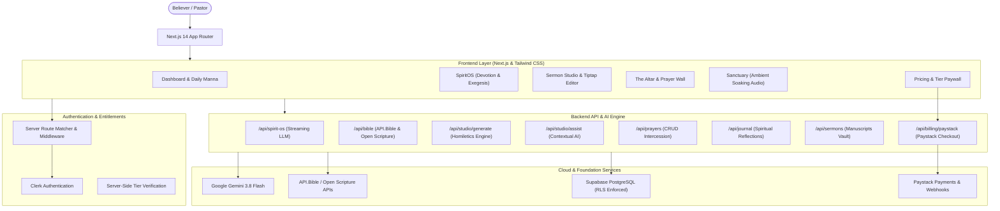

# Bible Rhema AI 🕊️ — Divine Intelligence Ecosystem

> An enterprise-grade, scripture-grounded AI companion and homiletics workspace designed for personal devotion, deep biblical exegesis, and pastoral sermon preparation.

---

## 🌟 Overview & Architecture

**Bible Rhema AI** combines modern full-stack web engineering, serverless architectures, and cutting-edge Large Language Models (LLMs) to create a trustworthy, reverent, and powerful biblical study ecosystem.



---

## 💎 Core Features

### 1. SpiritOS — Dual-Mode AI Theological Companion
* **Scripture Exegesis Mode**: Grounded biblical hermeneutics. Cites exact chapter & verse, provides Hebrew and Greek word studies (*hesed*, *shalom*, *agape*, *logos*, *rhema*), explains historical covenant contexts, and maintains strict distinction between biblical text and commentary.
* **Devotional Heart Walk Mode**: Pastoral, contemplative, and comforting. Offers scripture reflections, heart-searching questions, guided prayers, and practical daily action steps.
* **Low-Latency Streaming**: Real-time response streaming using `ReadableStream`.

### 2. Sermon Studio Pro — Homiletics Manuscript Architect
* **Rich Divine Editor**: Powered by Tiptap with typography styling, blockquotes, headings, lists, and formatting presets.
* **AI Homiletics Engine**: Generates 3-point expository outlines complete with attention-grabbing hooks, biblical cross-references, sermon illustrations, and altar call prayers.
* **AI Assist Suite**: Instant in-editor assistance — *Expand Thought*, *Rephrase Cadence*, and *Insert Scripture*.
* **Print-Ready PDF Export**: Export clean preaching manuscripts for the pulpit with one click.

### 3. The Altar & Sanctuary
* **The Altar (War Room)**: Track active intercessions, categorize prayer topics, and record answered prayers and testimonies of God's faithfulness.
* **Sanctuary Soaking Audio**: Background ambient soundscapes (*Latter Rain*, *Secret Place Piano*, *Deep Calls Meditation*, *Work & Worship Lo-Fi*) with floating audio player controls.

### 4. Subscription & Entitlement Paywall
* **Seeker (Free Forever)**: Daily Rhema reflection, prayer tracking, sanctuary audio soundscapes.
* **Disciple ($4.99/mo or $49.99/yr)**: Unlimited SpiritOS chat, full Hebrew/Greek exegesis mode, personal prayer journal, study streaks.
* **Minister ($12.99/mo or $129.99/yr)**: Complete Sermon Studio Pro, AI Homiletics Outline Generator, PDF Manuscript Export, and custom context research engine.
* **Server-Verified Security**: All paid capabilities are validated and guarded on the server via authenticated Next.js API routes and Supabase Row Level Security.

---

## 🛠️ Tech Stack

* **Framework**: Next.js 14 (App Router)
* **Language**: TypeScript 5
* **Authentication**: Clerk (`@clerk/nextjs`)
* **Database**: Supabase PostgreSQL with Row Level Security (RLS)
* **AI Engine**: Google Generative AI (`@google/generative-ai` Gemini 1.5 Flash)
* **Editor**: Tiptap Editor (`@tiptap/react`, `@tiptap/starter-kit`)
* **Styling**: Tailwind CSS & Lucide Icons
* **Payments**: PayPal Subscriptions (`@paypal/react-paypal-js`)

---

## 🚀 Getting Started

### 1. Clone & Install Dependencies
```bash
git clone https://github.com/bawagideon/bible-rhema-ai.git
cd bible-rhema-ai
npm install
```

### 2. Configure Environment Variables
Copy `.env.example` to `.env.local`:
```bash
cp .env.example .env.local
```

Fill in the keys from your provider dashboards:
```env
# Clerk Authentication
NEXT_PUBLIC_CLERK_PUBLISHABLE_KEY=pk_test_...
CLERK_SECRET_KEY=sk_test_...
CLERK_WEBHOOK_SECRET=whsec_...

# Supabase
NEXT_PUBLIC_SUPABASE_URL=https://your-project.supabase.co
NEXT_PUBLIC_SUPABASE_ANON_KEY=eyJ...
SUPABASE_SERVICE_ROLE_KEY=eyJ...

# Google AI (Gemini)
GOOGLE_AI_API_KEY=AIzaSy...

# PayPal (Subscriptions)
NEXT_PUBLIC_PAYPAL_CLIENT_ID=your-paypal-client-id
PAYPAL_CLIENT_SECRET=your-paypal-secret
```

### 3. Apply Supabase Database Migrations
Run the unified schema migration in your Supabase SQL Editor:
```sql
supabase/migrations/20261011_unified_production_schema.sql
```
This configures:
* `profiles` (with Clerk text ID foreign keys)
* `prayers`
* `sermons`
* `daily_rhema`
* `user_stats`
* RLS policies and `requesting_user_id()` function

### 4. Run Automated Tests
```bash
npm test
```
Verifies:
* SpiritOS Scripture Exegesis Engine
* SpiritOS Devotional Mode
* Sermon Studio Homiletics Engine
* In-Editor AI Assist Suite

### 5. Start Development Server
```bash
npm run dev
```
Open [http://localhost:3000](http://localhost:3000) in your browser.

### 6. Production Build Verification
```bash
npm run build
```

---

## ☁️ Deployment

### Deploy to Vercel
1. Push your repository to GitHub.
2. Import your repository into [Vercel](https://vercel.com).
3. In Project Settings > Environment Variables, add the keys from your `.env.local`.
4. Deploy! Next.js will automatically build and optimize all 15 static and dynamic server routes.

---

## 📜 License
MIT License. Built for Kingdom impact.
