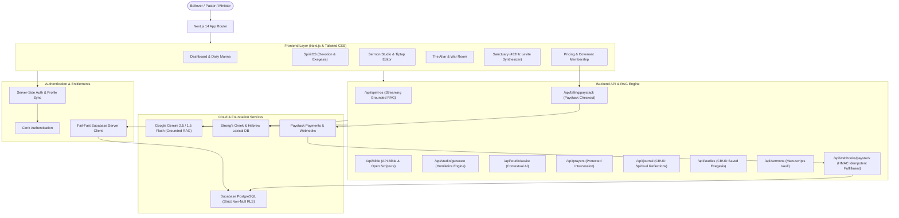

# Bible Rhema AI 🕊️ — Divine Intelligence Ecosystem

> **"Scripture first. Always. — Where the Word comes alive."**
> 
> An enterprise-grade, scripture-grounded AI theological companion and homiletics workspace designed for personal devotion, deep biblical exegesis, and pastoral sermon preparation.

---

## 🌟 Overview & System Topology

**Bible Rhema AI** combines modern full-stack web engineering, serverless architectures, and cutting-edge Large Language Models (LLMs) to create a trustworthy, reverent, and powerful biblical study ecosystem.



---

## 💎 Core Capabilities

### 1. SpiritOS — Grounded Exegetical & Devotional Engine
* **Scripture Exegesis Mode**: Grounded biblical hermeneutics. Cites exact chapter & verse, integrates comprehensive Strong's Hebrew and Greek lexical definitions (*hesed*, *shalom*, *agape*, *logos*, *rhema*, *parakletos*), cross-references verified Christocentric texts, and maintains strict separation between scripture canon and theological commentary.
* **Devotional Heart Walk Mode**: Pastoral, contemplative, and heart-searching. Delivers guided prayers, reflective questions, and actionable spiritual formation steps.
* **Living Context Side Panel**: Real-time study evidence panel rendering verified cross-references, interactive follow-up inquiry chips, and original language word studies.
* **Low-Latency Streaming**: Real-time response streaming using native Gemini token streaming with `X-Rhema-Context` structured metadata headers.

### 2. Sermon Studio Pro — Homiletics Manuscript Architect
* **Rich Divine Editor**: Powered by Tiptap with theological typography, scripture blockquotes, headings, lists, and formatting presets.
* **AI Homiletics Engine**: Generates 3-point expository outlines complete with attention-grabbing hooks, biblical cross-references, sermon illustrations, and altar call prayers.
* **AI Assist Suite**: Instant in-editor assistance — *Expand Thought*, *Rephrase Cadence*, and *Insert Scripture*.
* **Print-Ready PDF Export**: Export clean preaching manuscripts for the pulpit with one click.
* **Server-Tier Enforced**: Gated strictly to `MINISTER` tier with server-side validation.

### 3. The Sanctuary & The Altar (War Room)
* **The Sanctuary**: Contemplative resting space featuring the **Stillness Room** (guided breathing orb), **Scripture Soak** (peace navigator), and procedural audio synthesis.
* **Levite Procedural Audio Engine**: Web Audio API ambient soundscape mathematically tuned to true A4=432Hz harmonic concert pitch (C3=128.43Hz, G3=192.44Hz, C4=256.87Hz, E4=323.63Hz) and pink rain generator.
* **The Altar**: Real-time community prayer wall. Believers submit petitions, intercede for others with atomic count incrementing, and record answered prayers and testimonies of God's faithfulness.

### 4. Covenant Membership & Billing Security
* **Seeker (Free Forever)**: Daily Rhema devotional, personal prayer tracking, sanctuary ambient soaking.
* **Disciple (₦5,000/mo or ₦50,000/yr)**: Unlimited SpiritOS theological inquiry, Strong's Greek/Hebrew exegesis mode, personal prayer journal, study streaks.
* **Minister (₦15,000/mo or ₦150,000/yr)**: Full Sermon Studio Pro access, AI Homiletics Outline Generator, pulpit PDF manuscript export, and custom context research engine.
* **Enterprise Billing Security**: Canonical server price catalog, SHA-512 HMAC webhook signature verification, atomic idempotent fulfillment, and replay attack protection via dedicated `payment_transactions` ledger.

---

## 🛠️ Tech Stack

* **Framework**: Next.js 14 (App Router)
* **Language**: TypeScript 5
* **Authentication**: Clerk (`@clerk/nextjs`) with automated profile synchronization
* **Database**: Supabase PostgreSQL with strict non-null Row Level Security (RLS)
* **AI Engine**: Google Gemini (`@google/generative-ai`) with Exegetical Grounding RAG
* **Editor**: Tiptap Editor (`@tiptap/react`, `@tiptap/starter-kit`)
* **Styling**: Tailwind CSS & Lucide Icons
* **Audio**: Procedural Web Audio API Synthesizer (A4=432Hz Standard)
* **Payments**: Paystack Checkout & Webhooks

---

## 🚀 Getting Started

### 1. Clone & Install Dependencies
```bash
git clone https://github.com/bawagideon/bible-rhema-ai.git
cd bible-rhema-ai
npm install
```

### 2. Configure Environment Variables
Copy `.env.example` to `.env.local`:
```bash
cp .env.example .env.local
```

Fill in the keys from your provider dashboards:
```env
# Clerk Authentication
NEXT_PUBLIC_CLERK_PUBLISHABLE_KEY=pk_test_...
CLERK_SECRET_KEY=sk_test_...
CLERK_WEBHOOK_SECRET=whsec_...

# App URL
NEXT_PUBLIC_APP_URL=https://bible-rhema-ai.vercel.app

# Supabase
NEXT_PUBLIC_SUPABASE_URL=https://your-project.supabase.co
NEXT_PUBLIC_SUPABASE_ANON_KEY=eyJ...
SUPABASE_SERVICE_ROLE_KEY=eyJ...

# Google AI (Gemini)
GOOGLE_AI_API_KEY=AIzaSy...

# Paystack (Billing)
NEXT_PUBLIC_PAYSTACK_PUBLIC_KEY=pk_test_...
PAYSTACK_SECRET_KEY=sk_test_...
PAYSTACK_WEBHOOK_SECRET=...
```

### 3. Apply Supabase Database Migrations
Run the definitive security and integrity migration in your Supabase SQL Editor:
```sql
supabase/migrations/20261012_definitive_security_and_integrity.sql
```
This script dynamically drops legacy permissive policies across all tables, enforces non-null RLS, provisions the `payment_transactions` and `prayer_intercessions` tables, and creates the atomic `increment_prayer_intercession` RPC.

### 4. Run Automated Tests
```bash
npm test
```

### 5. Start Development Server
```bash
npm run dev
```
Open [http://localhost:3000](http://localhost:3000) in your browser.

### 6. Production Build Verification
```bash
npx tsc --noEmit
npm run build
```

---

## ☁️ Deployment

Deploy to [Vercel](https://vercel.com) by connecting your GitHub repository. Configure the environment variables from `.env.local` in the Vercel project settings.

Production URL: [https://bible-rhema-ai.vercel.app](https://bible-rhema-ai.vercel.app)

---

## 📜 License
MIT License. Built for Kingdom impact.
