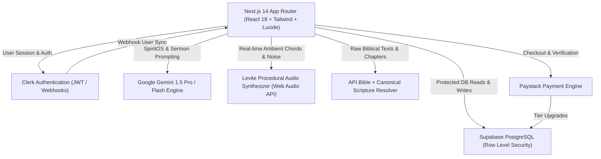

# Bible Rhema AI — System Architecture & Feature Catalog
**Tagline:** *"Scripture first. Always. — Where the Word comes alive."*  
**Palette:** Obsidian Night (`#0A0A0B` / `#121214`), Divine Gold (`#D4AF37` / `#F3E5AB`), Crisp Alabaster (`#F8F9FA`)  
**Deployment:** Production on Vercel (`https://bible-rhema-ai.vercel.app`)  
**Version:** Phase 3 Hardened Release  

---

## 1. System Architecture & Topology

---

## 2. Comprehensive Route & Feature Catalog

### A. Frontend Pages & User Journeys

| Route | Page Name | Core Functionality | Current State | Planned Improvements & Integrations |
| :--- | :--- | :--- | :--- | :--- |
| `/` | **Command Dashboard** | Daily Rhema devotional, user streak tracker, recent journal entries, saved studies carousel, quick launch to SpiritOS & Sanctuary. | **Active & Live.** Connected to `/api/daily-rhema` and `/api/user/stats`. Zero mock data. | Integrate Spotify/Apple Music for worship playlists, push notifications for daily devotional drop. |
| `/spirit-os` | **SpiritOS Theological Workspace** | AI Exegesis, Hermeneutic Deep-Dives, Devotional Meditations. Synchronized with the dynamic **Living Context Panel** (right sidebar). | **Active & Live.** Gemini-powered. Emits `X-Rhema-Context` headers for original Greek/Hebrew lexical analysis and cross-references. | Audio voice input (Web Speech API / Whisper), PDF export of exegesis briefs, sermon draft direct transfer. |
| `/studio` | **Sermon Architecture Studio** | Three-column pulpit preparation workstation: Outline Tree, AI Assist, Expository Editor, and PDF Export. | **Active & Live.** Gated to `MINISTER` tier with server-side enforcement. Upserts to Supabase `sermons` table. | Multi-speaker collaboration, auto-generated presentation slides (PowerPoint/Keynote format), sermon timing teleprompter. |
| `/sanctuary` | **The Sanctuary** | Contemplative prayer & spiritual resting space. Features: **Stillness Room** (breathing orb), **Scripture Soak** (peace navigator), and **Ambient Worship** (Levite Synthesizer). | **Active & Live.** 100% procedural audio (432Hz chords, 528Hz drone, pink rain, flowing waters), session countdown timer (5-20 min) with auto-pause. | Guided biblical audio meditations (recorded voices), custom prayer journal quick-capture modal. |
| `/altar` | **The Altar (Community Prayer)** | Prayer wall where believers submit petitions, intercede for others with one click ("I Prayed for This"), and track global prayer count. | **Active & Live.** Connected to Supabase `prayers` table. Real-time counter incrementing. | Anonymous prayer circles, church group filtering, real-time Supabase Realtime subscriptions. |
| `/library` | **Spiritual Library** | Repository for personal spiritual archives: Journal Notes, Saved Studies, and Sermon Manuscripts. | **Active & Live.** Filterable tabs, search bar, deletes and edits synchronized with Supabase. | Export complete spiritual history as ePub/PDF, full-text semantic vector search. |
| `/pricing` | **Covenant Membership (Billing)** | Subscription tier selection (`SEEKER`, `DISCIPLE`, `MINISTER`). Paystack checkout integration. | **Active & Live.** Supports USD and NGN via Paystack inline popups and server-side verification. | Add Stripe for international credit cards, RevenueCat for future iOS/Android app in-app purchases. |
| `/settings` | **Profile & Preferences** | Spiritual goals, Bible translation selector, preferred ministers, notification preferences, account tier display. | **Active & Live.** Tied to Clerk user info and Supabase `profiles` table. | Multi-translation side-by-side preference, dark/light/sepia Bible reader modes. |
| `/onboarding` | **Spiritual Intake Survey** | Multi-step assessment capturing goals, struggles, and preferred ministers upon first account creation. | **Active & Live.** Persists directly to user profile. | AI-personalized study plan recommendation generated immediately after onboarding completion. |

---

### B. Backend API Endpoints

| Route | HTTP Methods | Purpose | Security & Tiers |
| :--- | :--- | :--- | :--- |
| `/api/bible` | `GET` | Fetches raw Scripture text via API.Bible / bible-api / canonical cache. | Authenticated or Public. |
| `/api/spirit-os` | `POST` | Processes SpiritOS queries with Google Gemini, streams responses, extracts structured study context. | Clerk Authenticated. Free tier quota checked. |
| `/api/studio/generate` | `POST` | Generates structured 3-point expository sermon outlines. | Clerk Authenticated + `MINISTER` Tier only. |
| `/api/studio/assist` | `POST` | Contextual AI writing partner in the sermon editor (illustrations, Greek word studies, applications). | Clerk Authenticated + `MINISTER` Tier only. |
| `/api/sermons` | `GET`, `POST`, `DELETE` | CRUD storage for sermon drafts and outlines. | Clerk Authenticated. User-isolated via RLS. |
| `/api/journal` | `GET`, `POST`, `DELETE` | CRUD storage for spiritual journal reflections. | Clerk Authenticated. User-isolated via RLS. |
| `/api/studies` | `GET`, `POST`, `DELETE` | CRUD storage for saved exegesis studies and notes. | Clerk Authenticated. User-isolated via RLS. |
| `/api/prayers` | `GET`, `POST` | Fetches community prayer requests and submits new requests. | Clerk Authenticated. |
| `/api/prayers/intercede` | `POST` | Increments intercession counter when a user prays for someone. | Clerk Authenticated. |
| `/api/daily-rhema` | `GET` | Delivers the daily devotional passage, meditation, and confession. | Clerk Authenticated. Persisted per user per day. |
| `/api/user/profile` | `GET`, `PATCH` | Manages spiritual profile, goals, struggles, and preferences. | Clerk Authenticated. Strict field allowlist. |
| `/api/user/stats` | `GET` | Calculates authentic user streak, study count, prayer count, and sermons. | Clerk Authenticated. Zero mock data. |
| `/api/billing/paystack/initialize` | `POST` | Creates a verified transaction session with Paystack. | Clerk Authenticated. Prevents arbitrary amount manipulation. |
| `/api/billing/paystack/verify` | `POST` | Validates transaction with Paystack server, upgrades user tier in Supabase. | Clerk Authenticated. Strict reference binding. |
| `/api/webhooks/clerk` | `POST` | Receives Clerk user creation/update events and synchronizes profiles. | Webhook Signature Verified (Svix). Preserves paid tiers. |
| `/api/webhooks/paystack` | `POST` | Asynchronous webhook for successful charge notifications. | Paystack HMAC SHA512 Signature Verified. |

---

## 3. The Dynamic Living Context Panel

Located on the right side of the screen across desktop viewports, the **Living Context Panel** updates dynamically:

1. **Active Theological Context (`activeStudyContext`)**:
   - **Passage Focus**: Highlights the primary scripture reference, book, chapter, and testament.
   - **Original Language Lexicon**: Greek and Hebrew word studies with transliteration, Strong's Concordance numbers, and semantic depth.
   - **Cross-References**: Scriptural connections linked directly to biblical themes.
   - **Inquiry Exploration**: Suggested follow-up questions allowing rapid hermeneutical exploration.
2. **Dynamic Scripture Reader**:
   - Allows users to look up any biblical passage without leaving their active chat or study.
   - Powered by `/api/bible` with instant rendering.
3. **Quick Reflection Note**:
   - One-click note taking that saves directly to `/api/journal`.

---

## 4. The Sanctuary & Levite Soundscape Engine

Built around three distinct rooms:
- **Stillness Room**: Animated breathing orb (breathe in 4s, hold 7s, exhale 8s) for nervous-system calming and meditation on Psalm 46:10.
- **Scripture Soak Room**: Continuous meditative scrolling of curated peace passages (Philippians 4:6-7, Psalm 23, Isaiah 26:3, Matthew 11:28-30).
- **Ambient Worship & Rest Room**: Procedural Levite Synthesizer (Zero bandwidth, pure browser audio):
  - *Rainfall*: Pink-noise generator with low-pass resonance filter.
  - *432Hz Peace Chords*: Natural harmonic tuning triangle/sine synthesis.
  - *528Hz Transformation Drone*: Deep contemplative resonant drone.
  - *Flowing Waters*: Modulated white-noise synthesis.
- **Session Timer**: 5, 10, 15, or 20-minute countdown that automatically turns off audio when the timer finishes.

---

## 5. Security & Verification Status

- [x] **Zero Mock Data**: Hardcoded 12-day streaks and placeholder cards replaced with authentic Supabase queries.
- [x] **Database Fresh State**: All tables verified at 0 records for fresh user sign-in testing.
- [x] **Privilege Escalation Closed**: Deprecated unverified `/api/billing/verify` route (HTTP 410).
- [x] **Server-Side Tier Gating**: Sermon Studio generation restricted to `MINISTER` tier via server-side session checks.
- [x] **Clerk Webhook Tier Preservation**: User update events no longer reset paid users to `SEEKER`.
- [x] **Row-Level Security Hardened**: Phase 3 SQL migration eliminates anonymous access bypasses across all tables.
- [x] **Crisis Intervention Safeguard**: Pastoral safety detection for despair or self-harm triggers compassionate care and verified hotlines.
